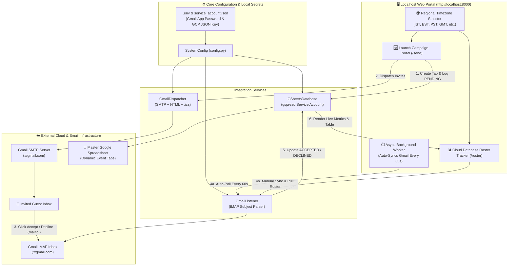
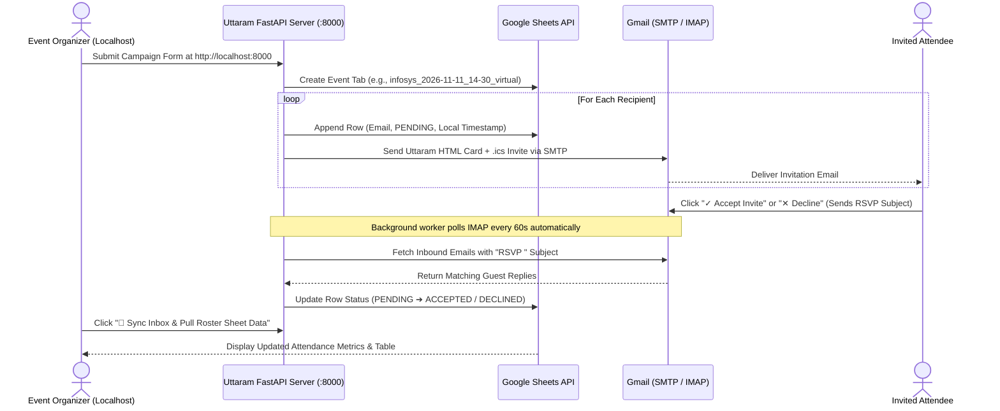

# ✉️ Uttaram — Enterprise Event Communications Engine (Localhost Edition)

An automated event invitation, calendar dispatch, and live RSVP tracking web server running locally on **`http://localhost:8000`** using **FastAPI**, **Gmail SMTP/IMAP**, and **Google Sheets APIs**.

Uttaram sends responsive HTML event invitations with timezone-aware `.ics` calendar attachments, logs initial guest states in Google Sheets, and automatically synchronizes inbound email RSVP confirmations (`ACCEPTED` / `DECLINED`) in the background every 60 seconds.

---

## 🏗️ System Architecture



---

## 🔄 End-to-End RSVP Lifecycle



---

## ✨ Key Features

* **Standalone Localhost Web Server**: Runs directly on `http://localhost:8000` via FastAPI and Uvicorn with zero third-party cloud hosting dependencies.
* **Hands-Free 60-Second Background Sync**: Includes an asynchronous background worker that continuously polls your Gmail inbox every 60 seconds and updates Google Sheets automatically.
* **Uttaram Branded HTML Invitations**: Responsive, table-based email cards with gradient banners, structured event metadata, and one-click `mailto:` RSVP action buttons.
* **Timezone-Aware `.ics` Calendar Invites**: Uses Python's `zoneinfo` module to generate accurate local timestamps for **India (`Asia/Kolkata`)**, **USA (`America/New_York`, `America/Los_Angeles`, etc.)**, **UK**, **UAE**, **Singapore**, and **Australia**.
* **Automated Google Sheets Provisioning**: Dynamically creates and manages individual worksheet tabs per campaign (`{company}_{date}_{time}_{type}`) without overwriting past events.
* **Multi-File Attachments**: Supports attaching PDFs, agendas, or onboarding guides alongside the `.ics` calendar file.

---

## 📂 Project Structure

```text
uttaram-localhost/
├── main.py                             # FastAPI server & background RSVP sync worker
├── .env                                # Local environment variables (Gmail & Sheet ID)
├── service_account.json                # Google Cloud Service Account credentials JSON
├── requirements.txt                    # Python dependencies
├── README.md                           # Project documentation
└── src/
    ├── core/
    │   ├── config.py                   # Loads .env & service_account.json
    │   └── exceptions.py               # Custom domain exceptions
    ├── services/
    │   ├── gmail_dispatcher.py         # SMTP email & .ics calendar generator
    │   ├── gmail_listener.py           # IMAP reply parser & RSVP synchronizer
    │   └── gsheets_database.py         # Google Sheets API wrapper (gspread)
    └── templates/
        ├── index.html                  # Localhost web portal interface
        └── invite_template.html        # Responsive Uttaram HTML email template
```

---

## 🚀 Localhost Setup & Installation

### 1. Clone & Install Dependencies
```bash
git clone <your-repository-url>
cd uttaram-localhost
pip install -r requirements.txt
```

```

### 2. Start the Localhost Server
```bash
uvicorn main:app --reload --port 8000
```
Open your browser and navigate to **`http://localhost:8000`**.

---

## 🛠️ Usage Guide

1. **Select Region / Timezone**: Choose your active region at the top of `http://localhost:8000` (defaults to **India `IST - Asia/Kolkata`**).
2. **Launch Campaign**: Under **🆕 Launch Campaign Portal**, enter the company/program name, date, time, format (`Virtual` or `Walk-in`), and recipient email addresses, then click **🚀 Authorise Workspace & Send Invitations**.
3. **Track Live Attendance**: Replies are synced automatically in the background every 60 seconds, or you can click **🔄 Sync Inbox & Pull Roster Sheet Data** under **📊 Cloud Database Roster Tracker** to refresh the table immediately.
