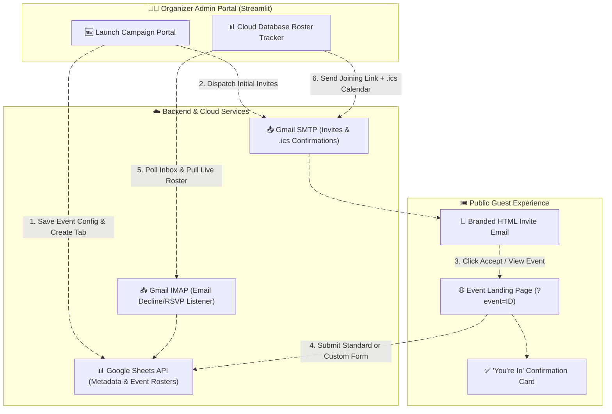
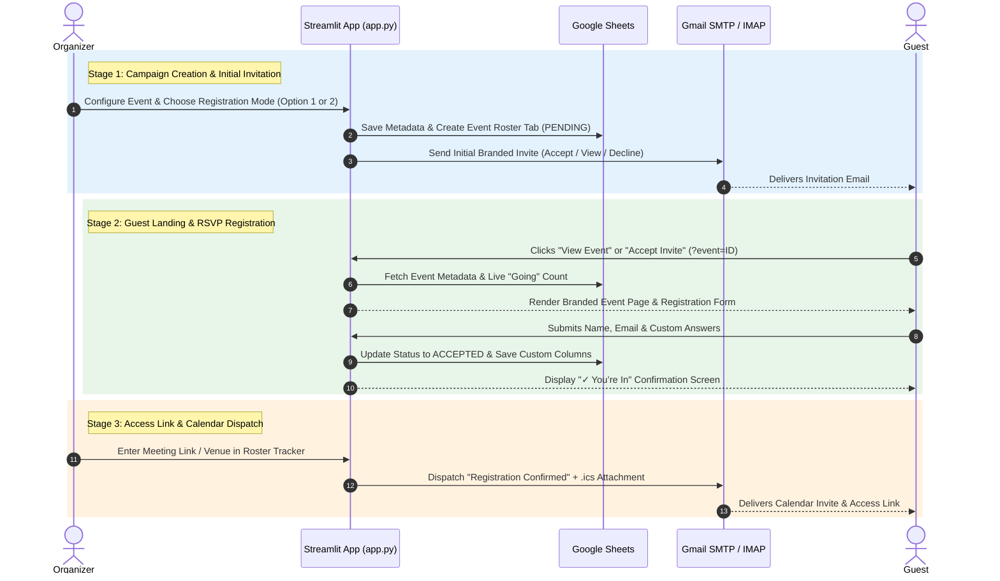

# ✉️ Uttaram — Enterprise Event Communications & RSVP Engine

**Uttaram** is an automated, cloud-ready event invitation, dynamic guest registration, and live RSVP tracking application built with **Streamlit**, **Gmail SMTP/IMAP**, and the **Google Sheets API**.

---

## ✨ Key Features

- **Dual-Mode Streamlit Portal**:
  - **Admin Workspace**: Private organizer dashboard with two navigation views (**Launch Campaign Portal** and **Cloud Database Roster Tracker**) plus multi-timezone support (`IST`, `EST`, `PST`, `GMT`, `GST`, `SGT`, `AEST`, `UTC`).
  - **Guest Event Landing Page (`?event=<campaign_id>`)**: Automatically hides the admin sidebar to render a clean, branded event page with cover banner, organizer info, live **Going** counter, formatted agenda, and instant registration.
- **Two Flexible Registration Modes**:
  - **Option 1 (Standard Registration)**: Collects `Full Name` and `Email` directly on the Event Page.
  - **Option 2 (Custom Registration Form)**: Automatically generates custom input fields (e.g., `Company Name`, `Job Title`, `Phone Number`) and dynamically appends matching columns to your Google Sheet roster tab.
- **Two-Stage Email & Calendar Workflow**:
  1. **Initial Invitation (`invite_template.html`)**: Sends a branded HTML email with **✓ Accept Invite**, **View Event**, and **✕ Decline** actions while keeping private meeting links hidden.
  2. **Post-Registration Confirmation (`.ics`)**: After registration, dispatches a **"Registration confirmed"** email containing the private **Meeting Join Link / Venue Address** and a timezone-aware **`.ics` calendar attachment**.
- **Automated Google Sheets Database (`gspread`)**:
  - Stores event configurations in `Campaigns_Metadata_00-00_config`.
  - Provisions isolated per-event roster tabs (`{company}_{date}_{time}_{type}`) with case-insensitive lookup and real-time RSVP status tracking (`PENDING`, `ACCEPTED`, `DECLINED`).

---

## 🏗️ System Architecture



---

## 🔄 End-to-End RSVP & Confirmation Lifecycle



---

## 📂 Project Structure

```text
event-manager/
├── app.py                              # Unified Streamlit Admin & Guest Event Portal
├── requirements.txt                    # Python dependencies (streamlit, gspread, ics, pandas)
├── README.md                           # Project documentation & architecture diagrams
└── src/
    ├── core/
    │   ├── config.py                   # Streamlit Secrets configuration loader
    │   └── exceptions.py               # Custom application exception classes
    ├── services/
    │   ├── gsheets_database.py         # Google Sheets tab & participant state manager
    │   ├── gmail_dispatcher.py         # SMTP HTML email & .ics calendar generator
    │   └── gmail_listener.py           # IMAP inbox RSVP parser
    └── templates/
        └── invite_template.html        # Responsive HTML invitation email template
```

---

## 🚀 Quick Start & Configuration

### 1. Install Dependencies
```bash
git clone https://github.com
cd event-manager
pip install -r requirements.txt
```

### 2. Run Locally
```bash
streamlit run app.py
```

---

## 📋 Usage Guide

1. **Launch a Campaign**:
   - Open **🆕 Launch Campaign Portal**, select your active timezone, and fill in the **Organization Name**, **Host Name**, **Event Title**, **Date/Time**, and **About Event** agenda.
   - Choose **Option 1** (Name & Email only) or **Option 2** (add custom comma-separated questions).
   - Enter recipient email addresses and click **🚀 Authorise Workspace & Send Invitations**.
2. **Track RSVPs & Send Joining Links**:
   - Open **📊 Cloud Database Roster Tracker**, select your campaign from the dropdown, and click **🔄 Sync Inbox & Pull Roster Sheet Data**.
   - Enter the **Meeting Join Link or Venue Address** and click **📨 Send Confirmation + .ics Calendar Invite to Accepted Guests**.
