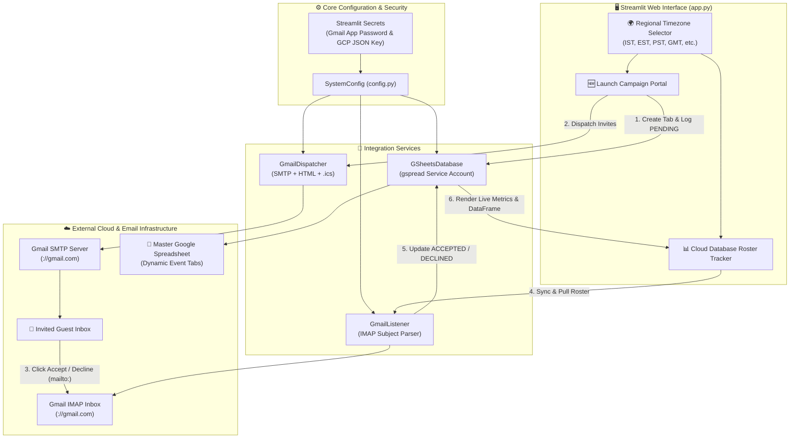
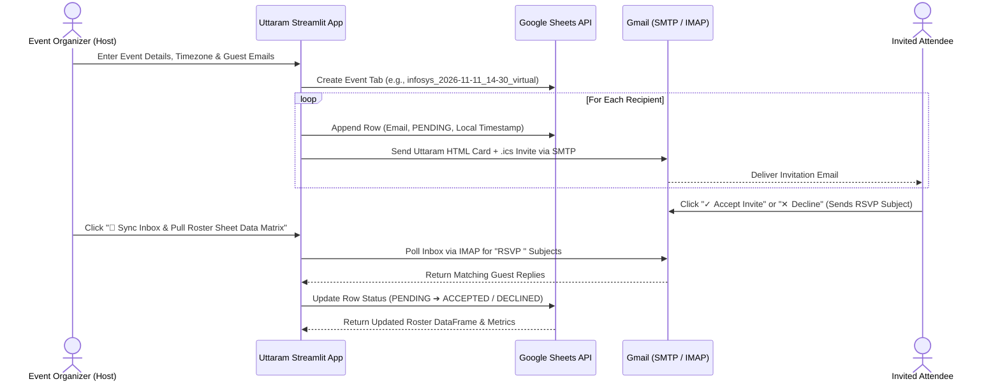

# ✉️ Uttaram — Enterprise Event Communications Engine

An automated event invitation, calendar dispatch, and live RSVP tracking system built with **Streamlit**, **Gmail SMTP/IMAP**, and **Google Sheets APIs**.

Uttaram sends sleek, responsive HTML event invitations with timezone-aware `.ics` calendar attachments, logs initial guest states in Google Sheets, and automatically synchronizes inbound email RSVP confirmations (`ACCEPTED` / `DECLINED`) back into a live dashboard.

---

## 🏗️ System Architecture



---

## 🔄 End-to-End RSVP Lifecycle



---

## ✨ Key Features

* **Uttaram Branded HTML Invitations**: Responsive, table-based email cards with gradient banners, structured event metadata, and one-click `mailto:` RSVP action buttons.
* **Timezone-Aware `.ics` Calendar Invites**: Uses Python's `zoneinfo` module to generate accurate local timestamps for **India (`Asia/Kolkata`)**, **USA (`America/New_York`, `America/Los_Angeles`, etc.)**, **UK**, **UAE**, **Singapore**, and **Australia**.
* **Automated Google Sheets Provisioning**: Dynamically creates and manages individual worksheet tabs per campaign (`{company}_{date}_{time}_{type}`) without overwriting past events.
* **One-Click Inbox Sync & Analytics**: Scans inbound RSVP emails via IMAP, filters out self-sent host messages, updates participant rows in place, and displays real-time **Accepted**, **Pending**, and **Declined** metrics.
* **Multi-File Attachments**: Supports attaching PDFs, agendas, or onboarding guides alongside the `.ics` calendar file.

---

## 📂 Project Structure

```text
uttaram-event-engine/
├── app.py                              # Main Streamlit UI (Campaign Portal & Roster Tracker)
├── requirements.txt                    # Python dependencies
├── README.md                           # Project documentation
└── src/
    ├── core/
    │   ├── config.py                   # Secrets loader & private key formatter
    │   └── exceptions.py               # Custom domain exceptions
    ├── services/
    │   ├── gmail_dispatcher.py         # SMTP email & .ics calendar generator
    │   ├── gmail_listener.py           # IMAP reply parser & RSVP synchronizer
    │   └── gsheets_database.py         # Google Sheets API wrapper (gspread)
    └── templates/
        └── invite_template.html        # Responsive Uttaram HTML email template
```

---

## 🚀 Setup & Installation

### 1. Clone & Install Dependencies
```bash
git clone <your-repository-url>
cd uttaram-event-engine
pip install -r requirements.txt
```

### 2. Configure Google Cloud & Google Sheets
1. Create a project in [Google Cloud Console](https://google.com) and enable both the **Google Sheets API** and **Google Drive API**.
2. Create a **Service Account**, generate a JSON key, and copy its `client_email` (e.g., `event-manager-sa@://gserviceaccount.com`).
3. Create a blank Google Spreadsheet, copy its **Spreadsheet ID** from the URL, and click **Share** to add the Service Account `client_email` as an **Editor**.

### 3. Configure Gmail App Password
1. Enable **2-Step Verification** on your host Gmail account.
2. Generate a **16-character Google App Password** under **Google Account > Security > App Passwords**.
3. Ensure **IMAP** is enabled in **Gmail Settings > Forwarding and POP/IMAP**.

```

### 4. Run the Application
```bash
streamlit run app.py
```

---

## 🛠️ Usage Guide

1. **Select Region / Timezone**: Choose your active region at the top of the app (defaults to **India `IST - Asia/Kolkata`**).
2. **Launch Campaign**: Open **🆕 Launch Campaign Portal**, enter the company/program name, date, time, format (`Virtual` or `Walk-in`), and recipient email addresses, then click **🚀 Authorise Workspace & Send Invitations**.
3. **Sync & Track Attendance**: Open **📊 Cloud Database Roster Tracker**, enter the matching event filters, and click **🔄 Sync Inbox & Pull Roster Sheet Data Matrix** to fetch new RSVP replies and view live attendance metrics.
